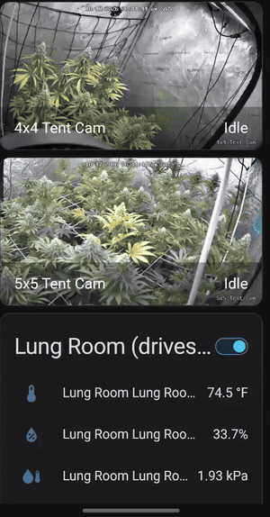

# Grow Automation

Open-source Home Assistant + ESPHome automation for indoor gardens: humidity
control, light schedules, and soil-moisture-driven drip watering. ESP32 +
BME280 sensors, off-the-shelf smart plugs, and one pump. You do no mains
wiring, and everything runs locally with no cloud. MIT licensed.



*The dashboard on a phone (a screen recording of a working install; [full-quality video](docs/dashboard-demo.mp4)). The recording is from an earlier version, so your entity names and cards may differ slightly.*

## What it does

- **Humidity control** with hysteresis, so plugs don't chatter, and
  failsafes that act or alert if a sensor goes offline.
- **Light schedules** per tent, set from dashboard settings (no code edits).
- **Soil-moisture-driven drip watering** with pump health checks and a
  runaway cutoff. See [`WATERING.md`](WATERING.md).
- **Feed and water logging**, a 9 AM reminder, and a phone-friendly dashboard.

## What you need

Home Assistant 2024.10 or newer, up to three ESP32 boards with BME280
sensors, smart plugs, and a pump. Parts and prices are in
[`SHOPPING-LIST.md`](SHOPPING-LIST.md) and
[`SHOPPING-LIST-WATERING.md`](SHOPPING-LIST-WATERING.md).

## About this build

The example setup is a shared humidity "lung room" feeding a 4x4 and a 5x5
tent. The YAML is split per tent and per sensor node, so you can adapt it to
your own layout. Other tents, such as a clone or seedling tent, are not
automated.

> **Project status:** the climate, lighting, and dashboard parts come from a
> working install. The watering package's configuration validates with
> `esphome config`, but it has not yet been tested on real hardware (see the
> end of [`WATERING.md`](WATERING.md)). Test it with the pump disconnected
> first, and please report what you find.

> **Safety:** this project switches mains-powered devices (pump, lights,
> humidifier, dehumidifier) through off-the-shelf smart plugs. You do no mains
> wiring, but use GFCI protection for anything near water, never exceed a
> plug's rating, and keep a manual way to shut everything off. Nothing here
> has been certified or tested on your hardware. You use it at your own risk.

## Running on the laptop now, moving to the Pi later

To cut cost up front, run Home Assistant OS in a free VirtualBox VM on
your spare laptop instead of buying the Pi right now — same OS, same
Supervisor, same add-on store as the Pi will run, so nothing in the rest
of this guide changes and nothing has to be redone when you switch.

1. Install VirtualBox (free, virtualbox.org — same tool regardless of
   whether the laptop runs Windows, Mac, or Linux).
2. Download the official HAOS VirtualBox image from
   home-assistant.io/installation/alternative/ (look for the VirtualBox
   `.vdi`/OVA under the x86-64 section — that's the right architecture
   for a laptop, unlike the Pi's ARM image).
3. New VM in VirtualBox: **at least 2048 MB RAM, 2 CPUs, UEFI enabled**
   (Settings > System > Motherboard > check "Enable EFI") — HAOS won't
   boot without UEFI on. Point the VM's disk at the downloaded image
   instead of creating a new one.
4. Boot it, then continue at step 2 below exactly as written — the VM
   answers to `homeassistant.local:8123` same as the Pi would.

**The laptop has to stay on and awake the whole time this is your hub** —
no sleep, no closed-lid suspend (Windows: Settings > System > Power >
Screen and sleep > set sleep to Never while plugged in; also uncheck
"sleep when lid is closed" in Control Panel > Power Options if it's a
laptop with a lid you'll close). If it sleeps, the humidity automation
and feed reminders stop running with it — worth being deliberate about
since that's not just "the dashboard's offline," it's "nothing's
watching the dehumidifier."

**Moving to the Pi later:** once you've got the CanaKit, take a full
backup from the laptop instance (Settings > System > Backups > Create
Backup), flash HAOS onto the Pi's SD card (same Raspberry Pi Imager step
below), boot it, and restore that backup during its onboarding wizard.
Everything — helpers, automations, dashboard, the ESPHome/smart plug
integrations — comes across in one shot. No redoing any of the steps below.

## Setup order

1. **Flash HAOS and boot the Pi.** The CanaKit in SHOPPING-LIST.md ships
   with plain Raspberry Pi OS preloaded, not HAOS — download the free
   Raspberry Pi Imager (imager.raspberrypi.com), pick "Other specific-purpose
   OS" > "Home Assistant" > "Home Assistant OS" as the image, target the
   kit's microSD, and write it (~10 min, overwrites the preloaded OS on
   purpose). Boot the Pi, then finish the Home Assistant onboarding wizard
   in a browser at `homeassistant.local:8123`.

2. **Install the HA Companion app** on your phone, log into your HA
   instance. Note the exact `notify.mobile_app_...` entity it creates
   (Settings > Devices & Services > your phone). The automations use
   `notify.my_phone`, so either rename yours to that or find-and-replace
   `notify.my_phone` with your real entity in `automations.yaml` and
   `packages/watering.yaml`.

3. **Set up the 4 smart plugs** (humidifier, dehumidifier, 4x4 light, 5x5 light).
   The pump gets its own Shelly plug, see `WATERING.md`.
   Depends which you bought (SHOPPING-LIST.md):
   - **Kasa Matter KP125M (recommended/cheaper):** enable Matter in HA
     first — Settings > Devices & Services > Add Integration > "Matter"
     (HAOS installs the Matter Server add-on automatically the first time).
     Pair each plug in the Kasa app, generate its Matter pairing code/QR
     there, then in HA's Matter integration choose "Add Device" and scan/enter
     that code. No TP-Link cloud account is used by HA at any point in this —
     the Kasa app is only there to get the plug onto your wifi and produce
     the Matter code.
   - **Shelly Plug US Gen4 (alternative):** set up via the Shelly app, then
     Settings > Devices & Services > Add Integration > Shelly in HA (finds
     them locally on your network, no cloud account needed).
   - Either way, rename the resulting `switch.*` entities to
     `switch.humidifier`, `switch.dehumidifier`, `switch.light_4x4`, and
     `switch.light_5x5` — or rename them however you like and update
     `automations.yaml`/`dashboard.yaml` to match.

4. **Flash the 3 ESPHome sensor nodes.** Install the ESPHome Builder add-on
   in HA (Settings > Add-ons > Add-on Store), or install the standalone
   `esphome` CLI on any PC. Copy `esphome/secrets.yaml.example` to
   `esphome/secrets.yaml`, fill in your real wifi creds (and change both
   `changeme123` passwords), then flash each
   node over USB the first time:
   - `esphome run lung-room.yaml` — mount in the lung room, away from the
     humidifier/dehumidifier's direct output stream (you want ambient
     room air, not a blast of mist/dry air).
   - `esphome run tent-4x4.yaml` — mount at canopy height inside the 4x4.
   - `esphome run tent-5x5.yaml` — mount at canopy height inside the 5x5.
   After the first flash they update over wifi (OTA) — no more USB needed.
   They'll auto-discover into HA within a minute or two of booting.

5. **Set up the 2 Reolink E1 cameras** (4x4, 5x5). Pair each in the Reolink app first (sets it up on your wifi,
   gives it a static-friendly local IP), then in HA: Settings > Devices &
   Services > Add Integration > "Reolink" > enter the camera's local IP,
   port 80, and its Reolink app username/password. Rename the resulting
   `camera.*` entities to `camera.tent_4x4` and `camera.tent_5x5` — or
   rename them however you like and update `dashboard.yaml` to match.
   No Reolink cloud account is needed for this — the integration talks to
   the camera directly over your LAN.

6. **Add the helpers.** Paste the contents of `homeassistant/helpers.yaml`
   into the matching `input_number:` / `input_datetime:` / `input_button:`
   sections of `configuration.yaml`, and `homeassistant/template_sensors.yaml`
   under a `template:` section. Then copy `homeassistant/packages/watering.yaml`
   into `config/packages/` and add this once to `configuration.yaml`:
   ```yaml
   homeassistant:
     packages: !include_dir_named packages
   ```
   Restart HA (Settings > System > Restart).

7. **Add the automations.** Paste `homeassistant/automations.yaml`'s
   contents into your `automations.yaml` (or add each one individually via
   Settings > Automations > Add Automation > Edit in YAML). Check these first:
   - `switch.dehumidifier` / `switch.humidifier` / `switch.light_4x4` /
     `switch.light_5x5` → match your real smart plug entity IDs from step 3.
   - `notify.my_phone` → your real notify entity from step 2.

8. **Add the dashboard.** Settings > Dashboards > Add Dashboard > New from
   scratch, then Edit Dashboard > (3-dot menu) > Edit in YAML, paste in
   `homeassistant/dashboard.yaml`.

9. **Set your targets (required, once).** The helpers have no built-in
   defaults, so until you set them the humidity ceiling sits at 30% and the
   lights at 00:00. On the new dashboard, dial in
   `input_number.tent_humidity_high_target` (start ~55%, drift down toward
   45% as the crop matures), `lung_room_humidity_low_target` (~45% is a
   reasonable dry-climate floor), `humidity_hysteresis` (3), and each tent's
   light on/off times. HA remembers them across restarts.

10. **Wall-mount the spare iPad as a live dashboard.** Free, since you
   already own it — install the Home Assistant app from the App Store,
   log into your HA instance, and set it to open straight to the Grow
   dashboard. Then:
   - **Settings > Display & Brightness > Auto-Lock > Never** — it needs
     to stay awake since it's a wall display, not a phone.
   - **Settings > Accessibility > Guided Access > On**, then triple-click
     the side/home button inside the HA app to lock the iPad to just that
     app — stops it from wandering off to the lock screen or another app
     if it gets bumped.
   - Keep it plugged into power full-time — Guided Access + always-on
     screen will drain a battery fast otherwise.
   - Any basic iPad wall/tent mount works — nothing HA-specific needed.
   The iPad is a display only, not the hub — the Pi still has to be
   running underneath it for this to show anything.

11. **Set up Tailscale for remote access.** Everything above only works on
    your home wifi by default — this is what lets you check the dashboard
    and camera feeds from your phone/laptop when you're not home, without
    a subscription or opening any ports to the internet.
    - On the HA host (Pi or the laptop VM): Settings > Add-ons > Add-on
      Store > search "Tailscale" > install the official add-on > start it
      > follow the login link it gives you to add this HA instance to
      your Tailscale network (a free "tailnet," up to 100 devices).
    - Install the Tailscale app on your phone, and on the iPad if you want
      it reachable there too when off wifi, and on any computer you'll
      check this from — sign into the same tailnet on each.
    - Once connected, reach HA from anywhere at its Tailscale address
      (shown in the add-on's log, or use `http://homeassistant:8123` if
      MagicDNS is on) exactly like being on the home network — no port
      forwarding, no cloud relay, your video/data never leaves your own
      devices and Tailscale's coordination layer.

## Customize the feeding schedule (use your own products)

The feed schedule on the dashboard is just a text card. The one in this repo
is an **example** (a living-soil routine). Replace it with whatever you feed.
Nothing in the automations depends on its contents, so you can't break
anything by editing it.

There are two files involved:
- `homeassistant/feed_reference.md`: your notes and sources (optional, for
  your own reference; Home Assistant never reads it).
- The "Feed Reference" card in `homeassistant/dashboard.yaml`: the text that
  actually shows on the dashboard.

**Option A: edit it in the Home Assistant UI (easiest)**
1. Open your Grow dashboard and click the pencil icon (top right) > **Edit
   dashboard**. If asked, choose "Take control".
2. Find the **Feed Reference** card, click **Edit** on it.
3. Replace the text in the **Content** box with your own (template below).
4. Click **Save**, then **Done**.

**Option B: edit the YAML**
1. In `dashboard.yaml`, find the card with `title: Feed Reference`.
2. Replace the text under `content: >` with your own. Keep every line
   indented the same amount as the existing lines, and leave a blank line
   between paragraphs so they show as separate paragraphs.
3. Paste the whole file back into your dashboard's raw editor (Edit dashboard
   > three-dot menu > Raw configuration editor) and save.

**Copy-paste template** (use `**bold**` for the things you don't want to miss):

```
**My base soil/medium**: one line about what it is and any rule that applies
to everything (for example "max once a week per product").

**Product 1**: dose per gallon, how often, when to start and stop.

**Product 2**: dose per gallon, how often, which stage only.

**Watering volume**: how much per watering for your pot size.
```

**Optional: change how often you're reminded to water.** Set
`Days Between Waterings` on the dashboard (Settings section). The 9 AM
reminder fires when a tent hasn't been logged as watered for that many days.
Press the **Watered** / **Fed** buttons on the dashboard to log them. Those
timestamps are for your own tracking: there is no automatic feeding reminder,
so if you want one, copy the `remind_water_4x4` automation in
`automations.yaml`, change `last_watered_4x4` to `last_fed_4x4`, and change
the message text.

**Optional: dose a different amount per tent.** Use two cards instead of one:
copy the Feed Reference card, then retitle them "4x4 Feed" and "5x5 Feed".

## Customize it for your setup (no code changes needed)

Everything below is a setting on the dashboard. You do not edit any code, and
changing a setting never changes how the automations are built. Home Assistant
remembers your values across restarts, except where noted.

**Light schedule** (any crop, any hours)
1. On the dashboard, find your tent's card (4x4 or 5x5).
2. Tap **Light On** and **Light Off**, pick your times, and confirm.
   Examples: 12/12 is on 7:00 PM, off 7:00 AM. 18/6 is on 7:00 PM, off 1:00 PM.
3. Done. The light plug and the watering window both follow these two times
   automatically (watering only runs while the lights are on). Each tent has
   its own times.

**Days between waterings** (the 9 AM reminder)
1. Dashboard > **Settings** card > **Days Between Waterings** (3 to 14).
2. Optional: this only controls the reminder. Auto-watering decides on its
   own from the soil moisture probes.

**Number of pots**
1. Dashboard > **Watering size** card.
2. Set **4x4 pots on drip** and **5x5 pots on drip** to how many pots each
   tent has (0 to 6). Set 0 for a tent you don't water with the pump.
3. The reservoir math and "water per cycle" update by themselves.

**Pot size** (how much water each pot gets)
1. Same **Watering size** card > **Gallons per pot**.
2. Rule of thumb: about 5-10% of the pot's soil volume per watering. That is
   1-2 gal for a 20 gal pot, 0.5-1 gal for a 10 gal pot, 0.25-0.5 gal for a
   5 gal pot.
3. The slider goes from 0.5 to 2.0 gal. **Optional, only if your pots are
   bigger than ~20 gal or smaller than ~5 gal:** open
   `packages/watering.yaml`, find `water_gal_per_pot:`, and change its `min:`
   or `max:` number. Restart Home Assistant.
4. Then re-measure your dripper flow (step 4 in `WATERING.md`) and set
   **Dripper flow per pot**. Run time is gallons per pot divided by dripper
   flow, and pulses over 12 minutes are refused, so smaller pots need less
   run time and bigger pots may need more pulses.

**Growing medium** (soil, coco, rockwool, and so on)
1. **Soil moisture trigger.** Dashboard > **Soil moisture** card > **4x4 dry
   below** and **5x5 dry below**. Watch your probe readings for a week while
   you water by hand, then set each to the reading where you would normally
   water. Different media dry out differently, so expect different numbers.
2. **Probe calibration.** Redo the dry and wet voltage numbers for your
   medium (`WATERING.md` setup step 2). A probe in coco reads differently
   from one in soil.
3. **Pulses and soak.** Dashboard > **Watering size** card > **Pulses per
   watering** and **Soak between pulses**. Living soil and peat mixes like
   3 pulses with 10 minute soaks. Fast-draining media such as coco or
   rockwool usually want smaller, more frequent waterings: try more pulses
   with shorter soaks, and less water per pot.
4. **Feeding notes.** Update the Feed Reference card (see above). The
   feeding numbers in this repo are for living soil. Hydroponic and coco
   feeds work very differently, so don't reuse them.
5. **Watering limits.** The 12 hour cooldown between automatic waterings is
   in `packages/watering.yaml` (look for `12 * 3600`). **Optional**: lower it
   if your medium needs watering more than twice a day.

## Why the automation is built this way

- **Dehumidifier** reacts to `sensor.worst_case_flower_tent_humidity`
  (the higher of the 4x4/5x5 readings) — a spike in either tent is a mold
  risk regardless of what the other tent or the room average is doing.
- **Humidifier** reacts to the lung room reading instead — low humidity is
  a room-supply problem (dry climate air), not something either tent's own
  canopy can fix, since transpiration only adds moisture, it can't remove
  it below what the room is already feeding in.
- Both use hysteresis (`input_number.humidity_hysteresis`, 3% suggested) so
  the plugs don't chatter on/off right at the threshold.
- **Failsafes:** if the lung room sensor is offline for 10 minutes the
  humidifier is switched off and you're notified; if both tent sensors are
  offline you're notified. If only one tent sensor is offline, the other one
  keeps driving the dehumidifier.
- The AC Infinity controller on the 4x4 keeps doing its own local
  fan-speed job untouched — this system only adds the humidity layer and
  the visibility the controller never had.

## Not in this build

- Camera monitoring — flagged as a good future add, intentionally out of v1.
- Light on/off only fires at the scheduled minute. If HA or Wi-Fi is down at
  that moment the plug won't be corrected until the next scheduled change, so
  check the lights after any outage.

## License and disclaimer

Released under the MIT License (see `LICENSE`). It is provided as-is with no
warranty, and you are responsible for the safety of your own installation,
including anything involving mains power, water, and electrical equipment.
This project is not affiliated with or endorsed by Home Assistant, ESPHome,
Shelly, TP-Link/Kasa, Reolink, Tailscale, or any product or brand it mentions.
Product names and links are examples, and prices and availability change.
